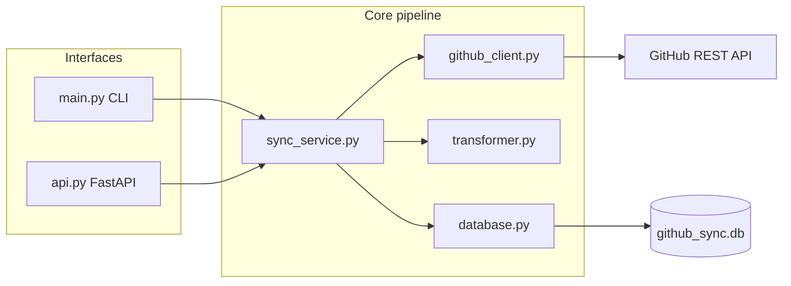
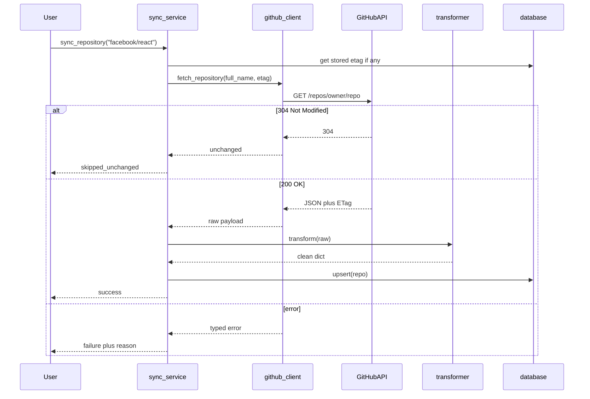

# GitHub Data Sync Connector

A beginner-friendly mini data integration system that fetches repository metadata from the GitHub REST API, transforms it into a clean record shape, and synchronizes it into a local SQLite database.

Built as interview preparation for data integration / ETL-style backend roles (for example, HevoData).

## Problem statement

Teams often need to pull data from SaaS APIs into a warehouse or local store on a schedule. This project demonstrates that pattern at a small scale:

1. Call an external REST API reliably.
2. Validate and reshape the payload.
3. Load into a database with UPSERT (no duplicate rows).
4. Handle timeouts, HTTP errors, and rate limits.
5. Optionally expose the sync flow behind a simple HTTP API.

## Architecture



### Module responsibilities

| Module | Responsibility |
|--------|----------------|
| `app/config.py` | Environment variables, timeouts, retries, logging setup |
| `app/github_client.py` | Extract: HTTP calls, auth header, retries, ETag / 304 |
| `app/transformer.py` | Transform: select fields, coerce types, validate |
| `app/database.py` | Load: SQLite schema, parameterized UPSERT |
| `app/sync_service.py` | Orchestrate extract → transform → load + summary |
| `app/schemas.py` | Pydantic models for FastAPI validation |
| `app/api.py` | Thin REST endpoints (no business logic duplication) |
| `main.py` | CLI entrypoint |

## Data flow



### Full sync vs incremental vs conditional requests

| Approach | What happens | Implemented here? |
|----------|--------------|-------------------|
| Full fetch every run | Always download the full JSON body | Yes (first sync / when no ETag) |
| Incremental sync (concept) | Only process source rows that changed (e.g. by `updated_at`) | Partially: we store `updated_at` and skip DB work on 304 |
| Conditional requests | Send `If-None-Match` with stored ETag; GitHub may return **304** with no body | Yes — this avoids unnecessary data retrieval |

This project does **not** claim full CDC (change data capture). Conditional GET with ETag is the honest network optimization.

## Technology stack

- Python 3
- GitHub REST API
- `requests` for HTTP
- SQLite for storage
- `pytest` for tests
- `logging` for application logs
- `python-dotenv` for configuration
- FastAPI + Uvicorn for optional REST endpoints

## Installation (macOS)

Requires Python 3.9+.

```bash
cd /Users/newtonschool/Github-Data-sync-connector
python3 -m venv .venv
source .venv/bin/activate
pip install -r requirements.txt
cp .env.example .env
```

Edit `.env` if you want a GitHub token (recommended for higher rate limits). Never commit `.env`.

## Environment configuration

| Variable | Default | Description |
|----------|---------|-------------|
| `GITHUB_TOKEN` | empty | Optional personal access token |
| `GITHUB_TIMEOUT` | `10` | HTTP timeout in seconds |
| `GITHUB_MAX_RETRIES` | `3` | Retries for timeouts, 429, 5xx |
| `DATABASE_PATH` | `github_sync.db` | SQLite file path |
| `LOG_LEVEL` | `INFO` | Logging level |

Unauthenticated GitHub API limits are low (~60 requests/hour). A token raises that significantly for public repository metadata.

## How to run (CLI)

```bash
source .venv/bin/activate
python main.py facebook/react pallets/flask
```

### Example output (illustrative)

```text
========================================================
SYNC SUMMARY
========================================================
[OK] facebook/react: Repository inserted successfully
[OK] pallets/flask: Repository inserted successfully
--------------------------------------------------------
Total repositories requested : 2
Successfully synchronized    : 2
Unchanged (conditional 304)  : 0
Failed repositories          : 0
Total execution time         : 1.234s
========================================================
```

Re-running soon after may show `[SKIP]` with HTTP 304 when the stored ETag still matches.

Exit code is `0` when all repos succeed or are unchanged, and `1` if any failed.

## FastAPI endpoints

> **Security note:** This demo has **no authentication**. That is intentional for a local interview project. Production systems must add access controls.

Start the server:

```bash
source .venv/bin/activate
uvicorn app.api:app --reload
```

Open interactive docs at `http://127.0.0.1:8000/docs`.

| Method | Path | Description |
|--------|------|-------------|
| `GET` | `/health` | Liveness + DB path + row count |
| `POST` | `/sync` | Sync a list of repositories |
| `GET` | `/repositories` | List stored repositories |
| `GET` | `/repositories/{repo_id}` | Fetch one repository by GitHub id |
| `GET` | `/sync/status` | Last in-memory sync summary for this process |

### Example: sync via API

```bash
curl -X POST http://127.0.0.1:8000/sync \
  -H "Content-Type: application/json" \
  -d '{"repositories": ["facebook/react", "pallets/flask"]}'
```

## Testing

Tests mock HTTP responses and use a temporary SQLite file. They do not require GitHub availability.

```bash
source .venv/bin/activate
pytest -v
```

Coverage includes:

- Successful API response
- Timeout / network failure
- HTTP 404
- Invalid JSON response
- Transformation validation
- Database insert + UPSERT + duplicate prevention
- Successful and failed synchronization

## Error handling and retries

Retried (transient):

- Timeouts and connection errors
- HTTP 429 (respects `Retry-After` when present)
- HTTP 5xx

Not retried:

- HTTP 404 (repo does not exist)
- HTTP 401 / 403 (auth/permission)
- Invalid JSON / missing fields
- Invalid `owner/repo` name format

Access tokens are never written to logs.

## Known limitations

- Syncs repository metadata only (not issues, PRs, or commit history).
- FastAPI `/sync/status` is process-local memory, not durable job state.
- No scheduler (cron / Airflow / Celery) is included.
- No authentication on the HTTP API.
- SQLite is single-file and local; not a production warehouse.
- Conditional sync depends on GitHub returning / honoring ETags.

## Future improvements

- Persist sync run history in SQLite.
- Add a scheduler for periodic syncs.
- Support organization-wide repository listing.
- Emit metrics (success rate, latency, rate-limit remaining).
- Add API authentication for any non-local deployment.
- Load into Postgres or a cloud warehouse instead of SQLite.

## Interview talking points

This project maps cleanly to connector / ETL vocabulary:

- **Extract** → `github_client.py`
- **Transform** → `transformer.py`
- **Load** → `database.py` (UPSERT)
- **Orchestration** → `sync_service.py`
- **Reliability** → retries, backoff, rate-limit handling
- **Idempotency** → same repo synced twice does not create duplicates

## License

Educational / interview preparation project.
